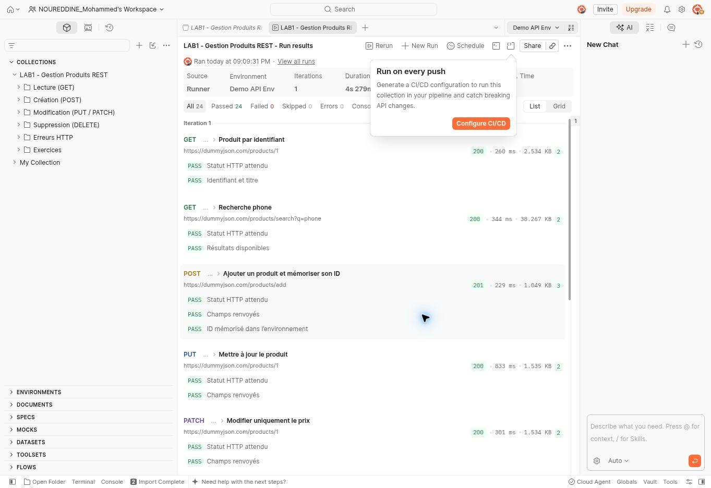
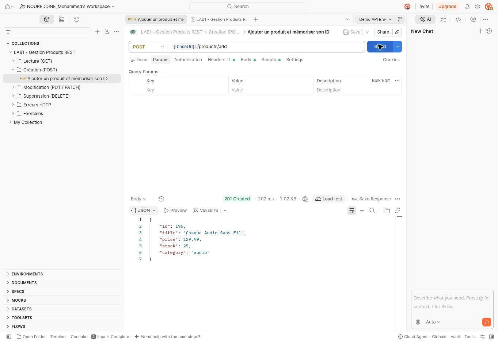

# Lab 1 — API REST avec HTTP et Postman

TP de Mohammed Noureddine sur l’API de démonstration DummyJSON.

## Exécution dans Postman Web

### Résultats de la collection

### Création d’un produit

La requête POST a renvoyé **201 Created**.

## Rapport

[Consulter le rapport du Lab 1 (PDF)](Rapport_LAB1.pdf)
